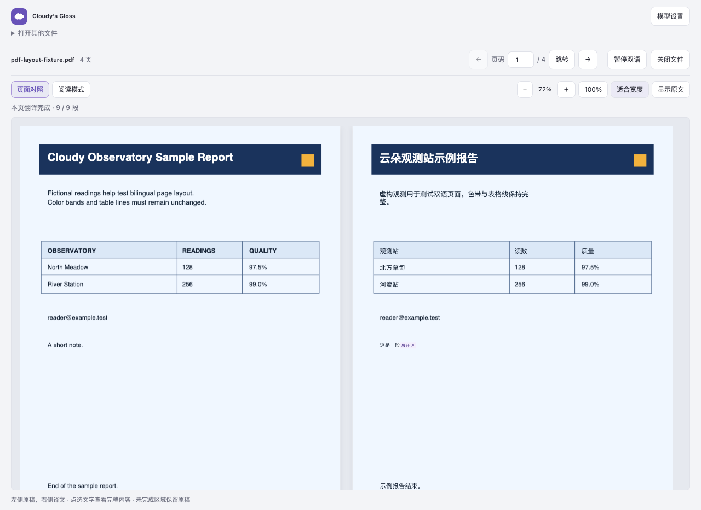
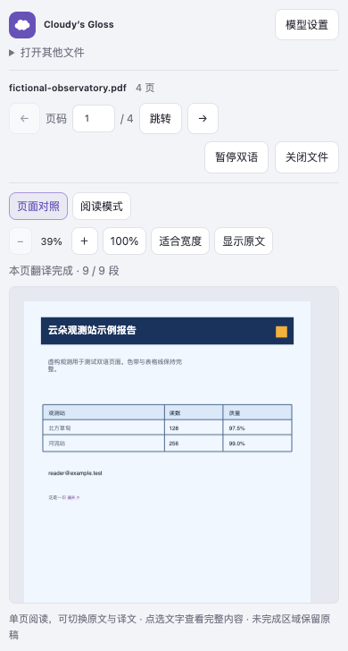

# PDF 原版式对照体验

日期：2026-10-05。本轮以原创观测报告验证排版，不使用用户截图中的私人文件或个人数据。技术依据与方案比较见 [技术调研](../research/2026-10-05-pdf-layout.md)。

## 本轮变化

- 桌面默认左原稿、右同版式译文，背景、图片、表格线和数值保持原位置；共用滚动容器与缩放。
- 一段完成就回填一段，未完成区域仍显示原稿。暂停与显示原文分开，恢复原文后画布逐像素一致。
- 译文最多缩至原字号的 80%；装不下就显示展开入口，详情完整保留原文和译文。中文行首避免孤立句号等闭合标点。
- 长详情只滚动正文，关闭按钮固定可见；支持键盘展开、Escape 关闭并返回来源焦点。
- 页面和阅读模式各自保存滚动位置，缩放围绕当前阅读位置。窄屏切成单页，放大平移限制在阅读区域。
- 数字、金额、百分比和邮箱等直接保留。后绘图形遮住的文字不出现在提取结果、详情或模型请求中；无法验证可见性的页面保留原稿。

## 截图

以下是 Chromium 生产构建在受控模型夹具中的实际截图，不代表模型质量评分。

| 390px 单页 | 长译文详情 |
| --- | --- |
|  |  |

## 验证与审核范围

✅ 完整网页与 PDF 浏览器回归 66/66，另外公开 PDF smoke 2/2。PDF 专项回归 14/14：Chromium 7 项、Firefox 7 项。使用真实 PDF.js、扩展消息、后台 provider 与缓存，可控模型负责稳定产生短译文与超长译文。

✅ 彩底、装饰方块、表格数值、邮箱及后绘表格线逐像素保留；原稿 hash 不变，覆盖区域之外的画布变化为 0。恢复原文时左右画布完全一致。

✅ 等待同批第二段时第一段已经显示；缩放和模式切换前后请求数均为 2，无额外模型请求。长详情完整文本、关闭按钮可命中、焦点返回、两种模式各自滚动位置、390px 单页边界均参与断言。

✅ 裁剪页不发送未经可见性确认的文字；扫描页显示原稿及 OCR 限制；被后绘白框覆盖的文字不出现在 UI 数据或请求中。

技术审阅覆盖绘制操作校验、局部遮挡、取消代次、画布预算和读取边界。体验审阅覆盖真实桌面与窄屏截图、原稿入口、详情和缩放；稳定用例在 `tests/e2e/pdf/pdf-layout.spec.ts`、`tests/e2e/pdf/pdf.spec.ts`。

Firefox 的扩展测试环境没有提供 `captureVisibleTab`，自动化输出明确的 unavailable 说明，不能将其当作截图。Firefox 的 DOM、几何、画布像素和交互断言完整运行；文档中的视觉截图来自 Chromium。

公开样例使用 [Mozilla PDF.js 双栏论文](https://mozilla.github.io/pdf.js/web/compressed.tracemonkey-pldi-09.pdf)：两种浏览器第一页均得到 106 个可见文字块、81 个翻译请求块，使用**阅读模式**，390px 无横向溢出，原稿切换可用。该结果证明真实 PDF 的提取与回退链路可用，不应当成复杂论文原位复排已经通过。

## 边界

不是任意 PDF 的出版级复排。复杂绘图、Type3、裁剪、蒙版等不能通过可见性验证时仅保留原稿；已确认可见、但几何不适合原位回填的文字使用阅读模式。两列长文本表格和双栏正文可能存在几何歧义。尚无 OCR、导出和手工拖动文本框。

本报告替代 [上一版 PDF 阅读体验](2026-10-05-components-pdf.md) 中段落列表及上下排列的现行说明；旧报告保留为历史记录。性能数字与口径见 [性能记录](../performance/2026-10-05-pdf-layout.md)。
