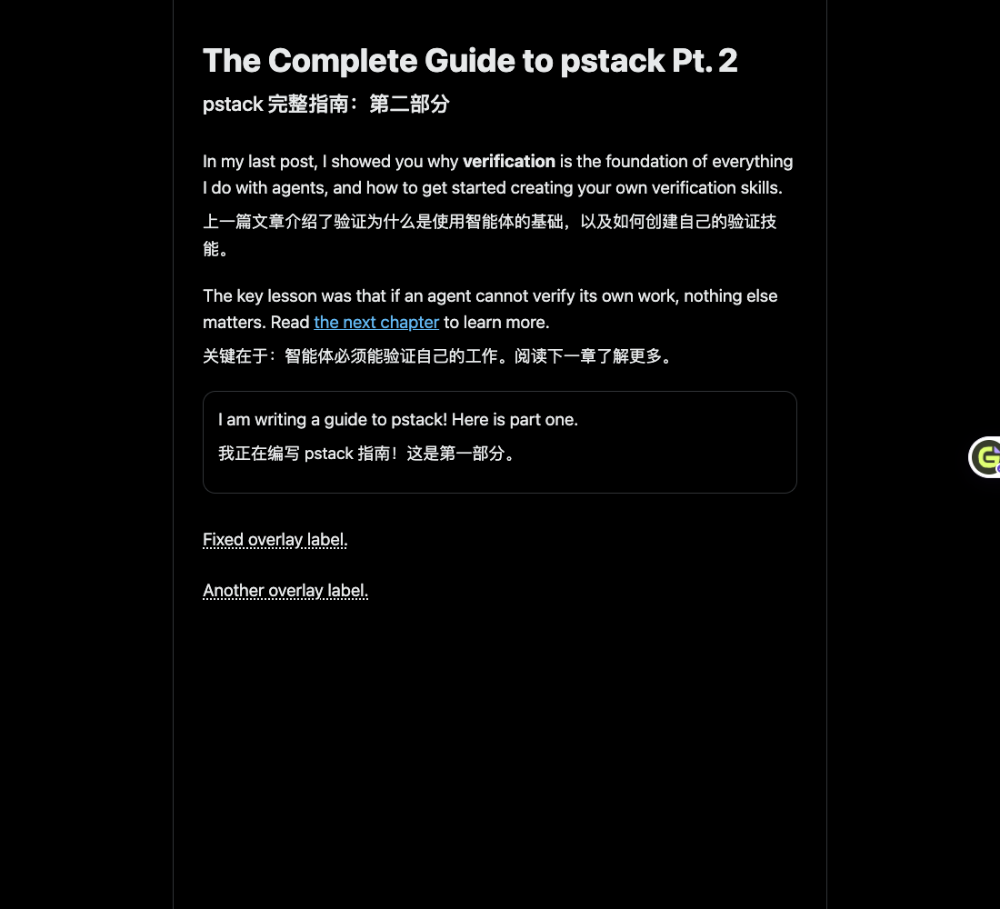
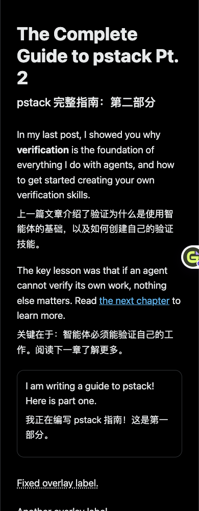

# X 文章双语显示修复与验证

## 问题与证据

用户提供的 [X 文章](https://x.com/poteto/status/2097732320606507506?s=12) 截图中，正文有虚线下划线但没有行内译文。代码中 `TranslationLayout.hintReady()` 正是以虚线标记悬浮译文，而 `PageTranslator.paint()` 会隐藏对应的行内节点。因此，截图与“正文被布局保护规则切换为悬浮译文”一致。

已复现的触发条件：文章位于绝对定位的虚拟列表单元中，原规则遇到任何绝对定位祖先都会启用悬浮译文。修复前单测失败；修复后，受控页面上的标题、正文、引用帖均直接显示双语。

**证据边界：本次没有成功读取用户已登录 X 页签的 DOM，浏览器连接持续超时，直接网页读取返回 403。夹具是自主构造的布局复现，不是该文章的真实 DOM 快照，不能据此宣布该线上页面已验收。** X 文章标记参考 [x2markdown 的公开实现与说明](https://github.com/RuochenLyu/x2markdown)，后续仍需在用户页面验证当前 X 布局是否与适配条件一致。

## 处理范围

- 仅对 X／Twitter 域名下的文章内容识别虚拟列表单元 `cellInnerDiv`。符合条件的绝对定位单元不再使整篇文章退化成悬浮译文。
- 不修改虚拟单元及外部列表的高度、定位或 transform，由宿主虚拟列表响应内容尺寸变化；仍检查外层固定定位祖先。
- 有显式行内高度、底部约束、最大高度限制或裁切的单元不使用该例外；文章内部真实浮层继续保留原保护。
- 增补 `twitter-article-title` 与 ARIA heading 的语义提取及标题排版，保留段内链接、强调文本，跳过编辑中的草稿。
- 沿用视口调度、增量扫描、批量请求和缓存。新增判断只发生在附近语义块准备布局时，不扫描全页，不添加观察器或模型请求。

## 验证结果

| 检查 | 结果 |
| --- | --- |
| `pnpm lint`、`pnpm typecheck` | 通过 |
| `blocks.test.ts`、`translator.test.ts`、`x-article-layout.test.ts` | 76 项通过 |
| `pnpm build`、`pnpm build:firefox` | 通过 |
| X 文章、复杂布局、常见组件 E2E | Chromium 与 Firefox 共 12 项通过 |
| 用户提供的真实 X 页签 | 待验收：连接超时 |

新增 E2E 场景：**X 长文章直接显示标题、正文和引用帖译文，滚动续译，后续评论不重叠且关闭后恢复**。同时检查 1100px／390px 宽度、段落上下间距、无横向溢出、宿主尺寸观察器推动后续评论、异步追加段落、首段不重复请求，以及关闭后精确恢复原 DOM。

模型响应为固定夹具，本次验证显示与交互，不评价译文质量或真实模型延迟。





复跑：

```sh
pnpm build
pnpm build:firefox
pnpm exec playwright test tests/e2e/layout/x-article.spec.ts tests/e2e/layout/layout-design.spec.ts tests/e2e/layout/component-design.spec.ts
```

构建更新 `.output/chrome-mv3` 与 `.output/firefox-mv2`；它不等于浏览器中已加载的扩展自动更新。Chrome 加载本地目录的用户需要重载扩展，再刷新文章页。本次未发布新版本，也未替换 Firefox 的永久安装包。
