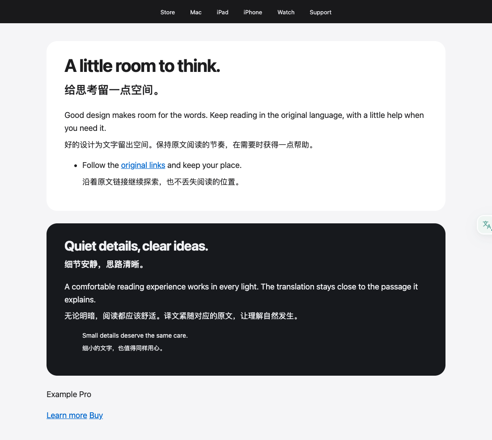

# 全文双语排版

默认保留导航、搜索区、菜单和操作控件原样，只为正文添加段下译文；导航文字仍可主动划词。文章页眉、普通列表、正文链接与页脚说明继续翻译。识别覆盖语义导航、ARIA 控件、常见 CTA、折叠摘要以及多短链接组成的旧式工具条，不依赖站点域名。

正文取消统一绿色竖线、左缩进和半透明效果。使用原文容器的颜色与字体、透明背景和 1.75 行高，标题译文缩小。视觉上由大号子元素构成的标题，按该子元素的字号和颜色生成译文，避免出现大标题下的小号灰字；这类颜色在插入时读取，普通正文继续动态继承宿主颜色。

固定高度卡片只有在新增译文造成溢出时才放开高度，普通自动排列的网格行同步增长，横向 flex 正文允许译文换行。共享 ResizeObserver 只跟踪已插入的译文、原文块及相关祖先，将关联祖先的布局读取与样式写入分批执行；流式文本回调不直接测量布局。关闭翻译恢复插件接管的样式，同时保留宿主页在会话中的更新。

滚动容器保持原高度，固定或绝对定位的阅读面板使用独立、共享的视口观察器预取附近段落，容器离屏后暂停。非滚动的绝对或固定定位覆盖层无法安全地为译文留出空间，自动翻译会跳过，仍可划词。已有重叠、命名网格区域及显式跨行跨列布局不会被强行重排。

仅由多个直接操作链接组成的按钮组不生成整段译文。模型确认返回与原文完全一致的内容时，不再显示重复行；这只减少冗余展示，不代表模型已经完成语义翻译。

加载态只保留轻微呼吸点。文本节点在流式更新时保持挂载，只在第一段文字出现时淡入，减少动态效果偏好继续生效。关闭后移除译文和会话样式。

以下是受控测试页面截图，译文由测试服务固定返回，用于排版验收，不是 Apple 官网或模型质量评分。体验设计代理复核了桌面与窄屏效果。

[390px 窄屏截图](images/bilingual-mobile.png)

回归入口：`tests/e2e/reading-design.spec.ts`，覆盖导航内容/高度不变、浅深颜色、宿主 CSS 污染、文章链接、主题切换、窄屏无横向溢出与完整恢复。Firefox 出现垂直滚动条时可用宽度会自然变窄，测试按页面实际宽度验收。

进一步的多站点实测、布局用例和设计师复核见 [多样化网页体验回归](2026-10-05-diverse-web-ux.md)。页面仍使用原有模型与缓存，本次不重评翻译语义质量。
