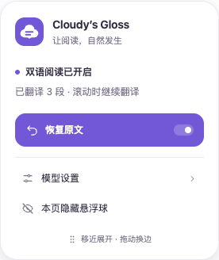
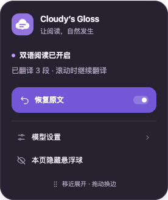

# 云朵悬浮球 · v2

2026-10-05。采用 [品牌方案](brand/README.md) 中的云朵与两条阅读线，用内联 SVG 绘制，避免给每个网页加载大尺寸 PNG。

## 视觉与交互

- 白色或深紫灰胶囊搭配紫色圆形主按钮，使用完整不透明表面、细描边和轻阴影。
- 默认贴边露出一半，主按钮点击切换双语；右侧独立入口打开快捷菜单。拖动超过 6 px 后作为换边操作，不触发翻译。
- 明暗主题保持相同结构。主操作文字使用白色配深紫底，菜单与正文保持视觉分隔。

## 动效

- 展开和收起：320 ms，快速启动、柔和停下，只改变 transform。
- 悬停：云朵轻抬 1 px；按下：主按钮缩至 94%。
- 开启双语：云朵轻微回弹一次，持续 380 ms。
- 翻译中：1.2 s 的细环旋转，两条阅读线以 1.5 s 周期交错淡入淡出。完成后撤掉进度环，显示静态勾标。
- 菜单：200 ms 淡入与轻微缩放，方向跟随菜单位置。
- 系统减少动态效果时禁用动画、过渡及按压缩放，保留静态进度环。标签页隐藏时暂停动画。空闲状态不持续播放动画。

动效使用 CSS transform/opacity，没有新增逐帧 JS 动画循环；拖动沿用 requestAnimationFrame 合并写入。所有菜单、状态和图标都放在已有的单个 Shadow DOM 控件中。

## 实际截图

## 回归

`tests/e2e/extension.spec.ts` 中新增「云朵悬浮球只在翻译期间显示进度动效，完成后静止，展开和忙碌状态不改变页面宽度」，同时扩展减少动态效果场景，验证静态进度提示。

与 `interaction-design.spec.ts` 一起在 Chromium 和 Firefox 验证 24 个场景，包括贴边与展开、左右拖动不误触、窄屏、浅色/深色、设置入口、恢复原文、点击外部关闭、Esc 焦点恢复和词卡交互。
