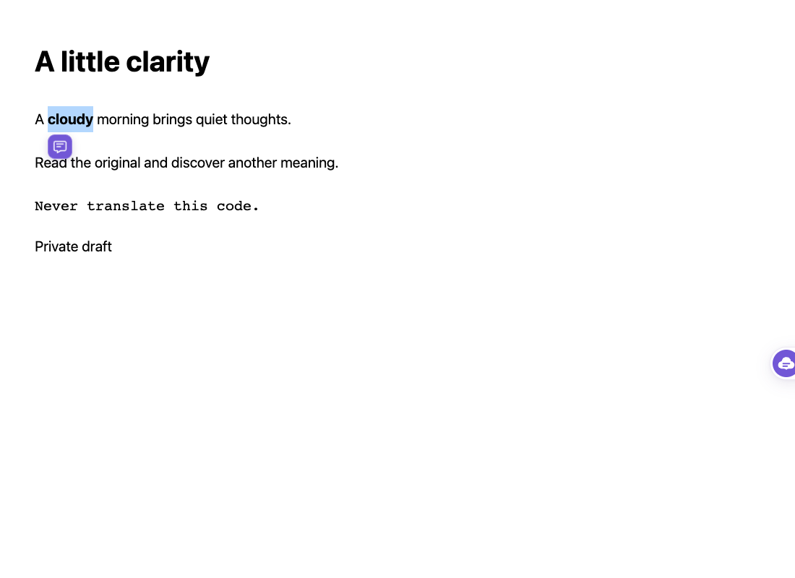
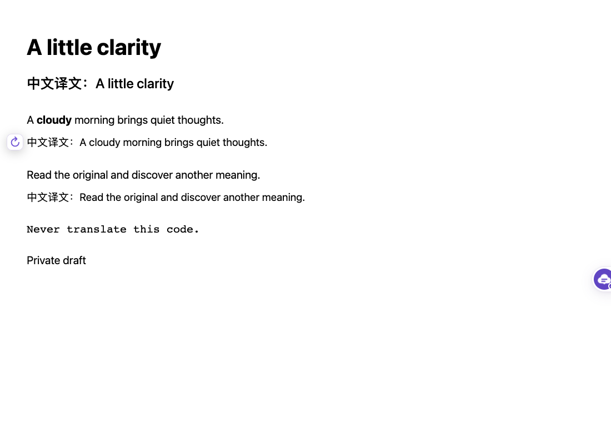
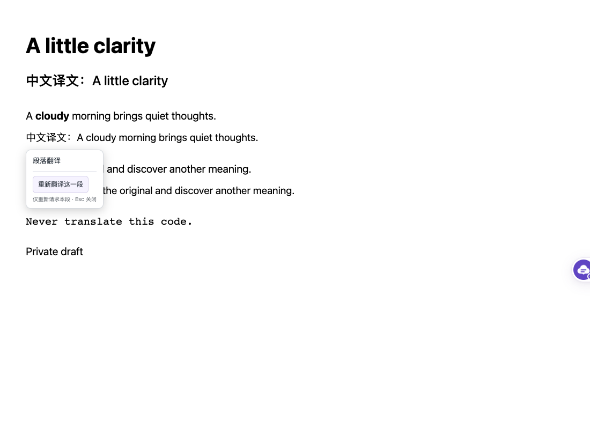

# 划词与段落操作入口

## 交互

- 划词只出现 34 px 紫色按钮，点击才请求模型并展开词卡，保持原选区；按钮有 140 ms 入场效果，遵循减少动态效果设置。
- 键盘选词后焦点进入小按钮，Enter 确认；Esc 返回原阅读焦点。
- 正文译文悬停或聚焦时只出现 30 px 重翻入口，优先放在段落侧边留白。点击入口、点击译文或按 Enter 才展开操作。
- 操作卡片不重复整段译文，仅显示操作、当前错误原因和重试状态。重试仍只请求当前段，失败保留已有译文。
- 受限导航等无法内联的组件仍显示译文提示；点击提示中的小入口、Alt+Enter 或触屏长按进入重试，不改变原控件点击行为。
- 入口和词卡复用一个 Shadow DOM 宿主，关闭即清理；没有轮询或全文扫描。取消选区、页面滚动、点外与 Esc 可关闭划词入口。

## 界面

## 回归用例

在 `tests/e2e/` 维护，使用受控模型响应验证交互和请求次数，不评估本地模型质量：

- 划词仅显示小按钮，点击后才请求词卡并展示音标释义例句，全页只有一个浮层
- 划词入口在窄屏保持屏幕内，取消选区或点击网页后消失且不请求模型
- 键盘选词后确认小按钮才进入词卡操作，Esc关闭词卡并恢复原阅读控件焦点
- 阅读译文时悬停或聚焦仅显示小入口，点击后展开重翻操作且不重复展示整段译文

其他相关回归包括页面事件拦截、普通 HTTP、窄屏词卡避让、模态框、逐段错误与缓存绕过、SPA 取消请求、恢复原文。
